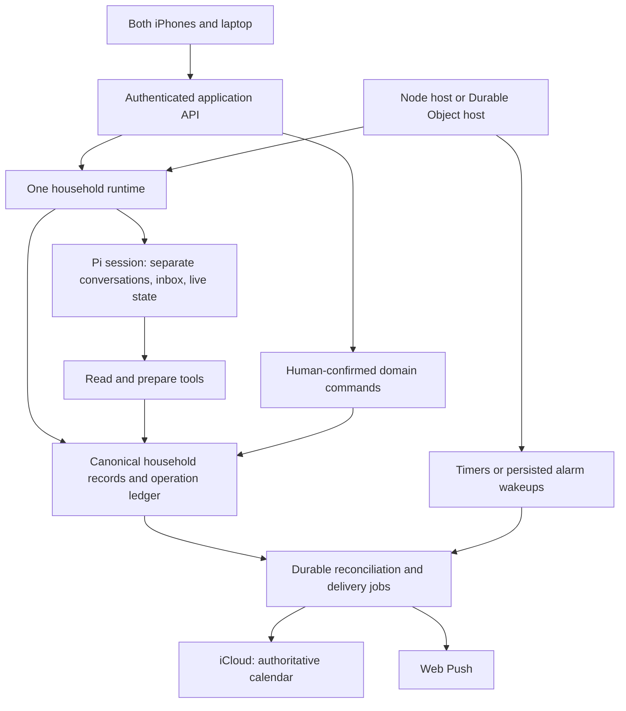

# Architectural review against Pi Durable's references

Reviewed on 17 October 2026 against application commit [`c85e65ac75b751767b3acce5e29804aadf637684`](https://github.com/hrmnjt/assistant/commit/c85e65ac75b751767b3acce5e29804aadf637684), the installed Pi Durable 1.2.0 API, the upstream package documentation and examples, both Earendil posts, and the official Cloudflare sample's implementation. Concurrent Cloudflare prototype work is outside this assessment. All architecture changes below are recommendations; the root README remains the working product specification and hosting remains undecided.

**Assessment:** Pi Durable fits this product. Our implementation currently makes model conversations durable while retaining a second application scheduler and several separate workflow ledgers around it. The biggest improvement is to make ownership of durable state explicit, use Pi's lifecycle primitives where they fit, and bridge external records through stable, recoverable commands.

The nine targeted probes across this review supplement the 44 passing existing tests. [Reproduction evidence](evidence.md) records their setup, observations, and limits, including a model-counting gap and a human-message dependency on paused AI. The [implementation review](review.md) covers the other findings and product/operational improvements.

## 1. Use the household as the durable ownership boundary

The Cloudflare reference places one Pi session in one Durable Object and supports several conversations inside it. For this product, the natural session is the household: the owner's assistant, the partner's assistant, and shared channels belong to the same runtime. This is an architectural recommendation inferred from the product's shared-state requirements and the [upstream hosting pattern](https://earendil.com/posts/pi-durable-on-cloudflare/).

Keep independent transcripts while sharing tasks, occurrence history, preferences, operation outcomes, and notification jobs. Creating one independently authoritative runtime per spouse or per chat would require cross-runtime coordination for those shared records. The existing single Node harness already aligns with the proposed household boundary.

On the Mac, one process owns that household runtime. If Cloudflare compute is selected later, one authenticated household Durable Object can own it. This mapping is a proposal, not a change to the agreed hosting decision.

## 2. Let Pi own the assistant inbox and run lifecycle

`server/conversations.ts` implements a second persisted queue with `assistant_runs`, `drain()`, startup re-admission, `watching`, and status transitions, alongside Pi's own submissions and live state. Some application metadata and admission policy are necessary, but the application should not have two independently writable definitions of whether one AI request is queued, running, or finished.

Pi's [inbox example](https://github.com/earendil-works/pi/blob/main/packages/durable/test/examples/20-inbox.ts) already covers ordered follow-ups, passive writes, withdrawal, and busy-conversation behavior. Prefer Pi submissions as the authoritative lifecycle. Keep the ten-message limit as explicit product policy, and treat any SQL status index as a rebuildable view.

Persist an authenticated request envelope containing actor ID, request ID, conversation identity, submission time, and relevant timezone/context. Bind tools to the durable request that owns the run. The present tool implementation instead looks up whichever external `assistant_runs` row is marked running, and its model wrapper initially parses a thread ID from prompt text. Identity and authority should come from stored, server-authenticated metadata rather than prompt formatting.

This requires care during refactoring: keep one actor's request per run, or explicitly support multiple actors if changing Pi's follow-up grouping. Native queueing alone does not replace the application's authorization rules.

## 3. Put workflow metadata in atomic durable commits

Use session-scoped documents for household-wide coordination and task-scoped documents/checkpoints for individual workflow progress. Small documents for request context, command receipts, and proposal links can be committed with the corresponding transcript entries. The [documents example](https://github.com/earendil-works/pi/blob/main/packages/durable/test/examples/01-documents.ts) demonstrates the atomic state-plus-entry pattern; the [extension-state example](https://github.com/earendil-works/pi/blob/main/packages/durable/test/examples/11-extension-state.ts) shows typed state owned by an extension.

Our current proposal path saves a preview in the household database, then separately inserts its assistant link, while Pi commits the tool outcome in another database. A crash can leave partial bookkeeping. Moving suitable workflow metadata into Pi reduces these gaps.

Keep task and occurrence records in application-owned SQL for now if that remains the clearest query model. Pi documents are an option for small shared aggregates, not a requirement to move every table. If domain data and Pi remain separately transactional, bridge them with a durable command/outbox and stable IDs. Sharing a physical SQLite file does not automatically make independent application and Pi transactions atomic.

The [storage documentation](https://github.com/earendil-works/pi/blob/main/packages/durable/README.md#storage) supports namespaced Pi tables and explains adapter queueing. In a shared Cloudflare database, all host access must use the supported queued database adapter; direct `ctx.storage.sql` writes can interfere with an active Pi transaction. Test the adapter rather than bypassing that boundary.

## 4. Model reminders and calendar writes as explicit workflows

`server/index.ts` currently wakes reminder planning with a 30-second interval and calendar sync with a one-minute interval. Stored notices offer partial recovery, but these timers are outside Pi's task lifecycle. The confirmed calendar write uses an additional `attempted`/lease mechanism whose unresolved outcomes produced two of the review's serious findings.

Use deterministic durable tasks for agreed reminder delivery, calendar operation reconciliation, and retries. A calendar command should carry the original preview, confirming actor, operation ID, expected ETag, desired fields, and current result. Checkpoint the intent before calling CalDAV and reconcile an uncertain result before deciding whether to write again. A delivery task should re-check current occurrence/recipient state and have a persistent retry deadline.

The [task example](https://github.com/earendil-works/pi/blob/main/packages/durable/test/examples/12-tasks.ts) explicitly separates preparing an operation, performing it with a stable key, and storing the outcome. Those are the useful mechanics to adopt. External services still need idempotency/preconditions and honest unknown outcomes; Pi does not make an iCloud write or a push delivery atomic with local storage.

These deterministic jobs should not require model inference to function. A paused or disconnected AI connection must not disable the household's existing tasks, human messaging, or reminder rules. A probe confirmed that `send(..., askAssistant=false)` currently fails if the unconfigured conversation has a pending AI request.

## 5. Treat Cloudflare wakeup and recovery as host responsibilities

The Cloudflare example has two separate pieces: Pi persists what work remains, while the host makes sure something wakes to perform it. Merely opening the SQLite adapter is insufficient.

The official [session implementation](https://github.com/earendil-works/pi-durable-cloudflare/blob/main/src/session.ts) initializes the harness before handling events, restores subscriptions, observes harness failure, and recalculates a persisted alarm. It sets a recovery alarm before enabling work, then recalculates after settlement. Its [schedule implementation](https://github.com/earendil-works/pi-durable-cloudflare/blob/main/src/schedule.ts) stores deadlines in task input/checkpoints.

Adopt that host pattern if choosing Durable Objects: project the earliest pending deadline onto the object's alarm, preserve a recovery wakeup while work is active, and make repeated alarm delivery harmless. Restore the live view after hibernation as well as the underlying records. On Node, provide equivalent process supervision, readiness, and orderly shutdown; watch `harness.closed` and reopen or restart after a storage failure.

Keep the two application sign-ins and all authorization checks. The upstream demo explicitly omits authentication and rate limiting, so a shareable session URL from that demo cannot become this household's access-control model. See its [README](https://github.com/earendil-works/pi-durable-cloudflare/blob/main/README.md).

## 6. Build the UI from committed snapshots and updates

The current client polls a full household snapshot every five seconds, messages and assistant state every three seconds, and presence every ten seconds. It reconstructs running state and proposals from separate application queries. This is manageable for two users, but it makes reconnection, partial output, and operation recovery harder to reason about.

Use a product-facing event adapter over Pi's committed state. Start each connection with a snapshot, then send committed updates; reconnect by getting a fresh snapshot and retrying unacknowledged commands with the same request ID. The [late-join example](https://github.com/earendil-works/pi/blob/main/packages/durable/test/examples/21-late-join.ts) demonstrates both structural views and event streams.

SSE is sufficient for a Node implementation; hibernating WebSockets fit the Cloudflare reference. Preserve a stable application DTO/protocol so the frontend is not tied to every experimental Pi event shape. Keep presence transient with expiry, separate from durable business state. Add history pagination: compaction bounds model context while historical messages remain stored, so it does not justify our unpaginated 200-entry display limit.

## 7. Preserve the product's stronger confirmation boundary

Keep the assistant limited to reading and preparing. A signed-in human confirms through the application command path, and both direct controls and chat proposals use the same domain validation. Do not copy the example todo tool's direct mutation behavior into this product.

Mark replay policy according to the effect. A read can safely replay. Preparing a preview can be made replay-safe with a stable command key and atomic receipt. A confirmed calendar operation must reconcile its durable intent using remote identity/ETag checks. A task replay declaration is not permission to perform a new unconfirmed action.

Background chores and reminders should belong to the household runtime, so cancelling one assistant response cannot cancel tomorrow's agreed reminder. Short-lived model/tool work can remain owned by its generation. Optional history search can start as a simple read-only tool; the demo's subagent machinery is useful only when a multi-step retrieval flow earns the extra complexity.

## 8. Cover maintenance inference, failures, and upgrades

Our `boundedModels()` proxy intercepts `streamSimple` but binds `completeSimple` to the original Models instance. Pi uses `completeSimple` for compaction. The isolated probe made one provider call through that route while the application's model-call table stayed at zero. Decide whether the eight-turn limit is a generation-loop limit or a complete inference budget; if the latter, meter and bound maintenance calls too. Pi's [compaction example](https://github.com/earendil-works/pi/blob/main/packages/durable/test/examples/25-compaction.ts) is a useful regression template.

Use native usage and task metadata where possible, with explicit application limits and safe error categories. Preserve actor identity without requiring every background compaction to impersonate the current human request.

Pi Durable labels its API experimental. Continue exact dependency pins, isolate integration code behind a small adapter, and version durable application documents/tasks. Include restart tests when upgrading definitions. The [recovery example](https://github.com/earendil-works/pi/blob/main/packages/durable/test/examples/13-recovery.ts) and [reload/restart example](https://github.com/earendil-works/pi/blob/main/packages/durable/test/examples/31-reload-and-restart.ts) illustrate the boundaries to test. Do not assume a newer upstream example is an unchanged contract for the pinned release.

## Proposed shape

Keep the same household policies and domain commands in both hosts. Isolate storage, wakeup scheduling, credential persistence/refresh, push transport, and client streaming behind narrow interfaces. The current Node `DatabaseSync`, filesystem-backed credentials, and process timers are implementation-specific edges to extract incrementally. A Cloudflare spike can validate those adapters; promote it into the same product core once validated.

Recommended sequence: repair the confirmed calendar/notification defects; establish command and occurrence models; simplify assistant queue ownership; add durable job and view adapters; validate Node/Cloudflare recovery behavior; then choose hosting on the evidence. The hosting move should not become the mechanism for fixing unclear state ownership.
